# Bitácora de Zafra 🌾

**CC3092 · Deep Learning y Sistemas Inteligentes — Proyecto 3: Casos de uso de LLM**
Universidad del Valle de Guatemala · Nicolás Concuá (23197) y Esteban Cárcamo (23016)

Convierte las **notas informales de campo** de un ingenio azucarero (WhatsApp o audio) en **reportes
estructurados y alertas accionables**. El caporal escribe *"ing en el 47 todavía hay 4 jaulas, se quemaron
antier a las 10 de la noche y el ingenio no ha recibido"* y el jefe de cosecha ve en el tablero:
lote F-47, 100 t de caña quemada hace 44 h, **~1 t de azúcar ya perdida y ~0.6 t más si espera 24 h**.

## El problema

Durante la zafra, los supervisores reportan su jornada con mensajes informales. Alguien los pasa a mano a una hoja
de cálculo horas después y, mientras tanto, nadie detecta a tiempo la **caña quemada que espera ser molida**
(pierde sacarosa cada hora), los paros largos de maquinaria o los accidentes. Un formulario rígido no funciona
en el campo; las expresiones regulares fallan con la jerga, los números en letras y las horas coloquiales.
Un LLM entiende el lenguaje del campo, y **reglas deterministas** del ingenio hacen los cálculos.

## Arquitectura

```mermaid
flowchart LR
    A[Nota de texto<br/>o audio] --> B[Transcripción<br/>Gemini multimodal]
    B --> C[Preprocesamiento<br/>limpieza · límite · delimitadores]
    A --> C
    C --> D[Embedding de la nota<br/>gemini-embedding-001 · 768 d]
    D --> E[Similitud coseno<br/>vs. banco few-shot · top-4]
    C --> F
    E --> F[Prompt: reglas + catálogo<br/>+ 4 ejemplos + nota]
    F --> G[LLM · salida JSON<br/>con esquema estricto]
    G --> H[Validación<br/>Pydantic · catálogo · rangos<br/>autocorrección]
    H --> I[Reglas del ingenio<br/>horas desde quema · KATC<br/>azúcar en riesgo · alertas]
    I --> J[Confirmación humana<br/>campos dudosos]
    J --> K[(SQLite)]
    K --> L[Tablero web<br/>KPIs · alertas · CSV]
```



El LLM **solo extrae hechos**; toda la aritmética (jaulas → toneladas, horas desde la quema, pérdida de azúcar)
es determinista, así que un error de cálculo del modelo nunca llega al tablero.

| Componente | Tecnología |
|---|---|
| LLM principal | `gemini-3.5-flash-lite` (API de Gemini) |
| Comparaciones | `gemma-4-26b-a4b-it` (pesos abiertos, MoE), `gemini-3.5-flash` |
| Embeddings | `gemini-embedding-001`, 768 dimensiones, similitud coseno, top-k = 4 |
| Backend | Python 3.12, FastAPI, Pydantic, SQLite |
| Frontend | React + Vite (responsive, pensado para celular) |
| Evaluación | 60 notas propias + scripts en `eval/` + notebook de análisis |

## Instalación y ejecución

Requisitos: Python 3.12+, Node 18+ y una llave de la API de Gemini (https://aistudio.google.com/apikey).

```bash
git clone https://github.com/nicoCT04/Proyecto3-LLMS.git
cd Proyecto3-LLMS

python3 -m venv .venv
source .venv/bin/activate
pip install -r requirements.txt

cp .env.example .env            # y pegar GEMINI_API_KEY

cd frontend && npm install && npm run build && cd ..
cd backend && uvicorn app:app --host 0.0.0.0 --port 8000
```

Abrir http://localhost:8000. Desde un celular en la misma red: `http://<ip-de-la-computadora>:8000`
(el dictado por voz requiere https o localhost; escribir la nota funciona siempre).

Para desarrollo del frontend con recarga en caliente: `cd frontend && npm run dev` (proxy de `/api` a `:8000`).

**Modo demo (plan B de la feria):** primero `cd backend && python precalentar.py` (deja en caché las notas de
ejemplo con la configuración actual) y luego `ZAFRA_DEMO=1 uvicorn app:app ...`: la app responde solo desde la
caché en disco, sin internet ni API (las notas de ejemplo y las del conjunto de evaluación funcionan; una nota
nueva devuelve un aviso claro).

**Bot de Telegram:** el caporal manda la nota por texto o audio a un bot y recibe el reporte y las alertas; la nota
queda en el Tablero sin confirmar. Crear el bot con @BotFather, poner `TELEGRAM_TOKEN` en `.env` y correr
`cd backend && python bot_telegram.py` (long polling: no necesita URL pública; corre mientras la computadora esté
encendida).

## Reproducir las métricas

```bash
python data/construir_dataset.py      # regenera eval_set.jsonl y fewshot_pool.jsonl
python eval/evaluar.py --it It0 It1 It2 It3 It4 It5 It6 It7   # escribe eval/resultados/
python eval/evaluar.py --it It8 --split test --muestra 18       # modelo grande: cuota de 20 solicitudes/día
python eval/tabla_readme.py           # actualiza la tabla de abajo
python notebook/construir_notebook.py
jupyter nbconvert --to notebook --execute --inplace notebook/proyecto3.ipynb
```

Todas las respuestas del LLM quedan en `data/cache/` indexadas por el hash de (modelo, prompt, parámetros), así
que re-ejecutar la evaluación reproduce exactamente las mismas métricas sin costo. `--split dev|test` y
`--it It0 It5` permiten correr subconjuntos.

Pruebas de las partes deterministas (conversión de unidades, anclaje del lote, horas desde la quema, alertas,
baseline y delimitadores): `python -m pytest tests -q`.

## Resultados (split test)

<!-- RESULTADOS -->
| It. | Cambio | n | F1 | Notas exactas | F1 alertas | Alucinación | Latencia (s) | US$ / 1000 |
|---|---|---|---|---|---|---|---|---|
| It0 | Baseline sin LLM: expresiones regulares y palabras clave | 40 | 0.823 | 32 % | 0.774 | 5.0 % | 0.00 | 0.00 |
| It1 | Prompt simple, modo JSON sin esquema (zero-shot) | 40 | 0.756 | 18 % | 0.812 | 8.3 % | 0.98 | 0.08 |
| It2 | Prompt detallado (reglas + catálogo + seguridad) y esquema estricto | 40 | 0.971 | 78 % | 1.000 | 2.3 % | 1.11 | 0.18 |
| It3 | It2 + 4 ejemplos few-shot fijos | 40 | 0.968 | 80 % | 1.000 | 1.8 % | 1.13 | 0.24 |
| It4 | It2 + 4 ejemplos few-shot elegidos por embeddings (coseno, top-4) | 40 | 0.971 | 85 % | 0.973 | 1.8 % | 1.32 | 0.24 |
| It5 | It4 + validación contra catálogo y autocorrección del JSON | 40 | 0.971 | 85 % | 0.973 | 1.8 % | 1.32 | 0.24 |
| It6 | It5 + prompt v3: aclaraciones de lote numérico y tipo de corte (análisis de errores en dev) | 40 | 0.974 | 85 % | 0.973 | 1.2 % | 1.14 | 0.25 |
| It7 | Configuración de It6 con un modelo abierto (Gemma 4 26B MoE) | 40 | 0.967 | 85 % | 0.973 | 0.6 % | 30.96 | 0.00 |
| It8 | Configuración de It6 con el modelo grande (gemini-3.5-flash, muestra de 18) | 18 | 0.979 | 94 % | 1.000 | 0.0 % | 1.64 | 0.95 |
<!-- /RESULTADOS -->

It8 se evaluó sobre una muestra de 18 notas de test porque el tier gratuito limita `gemini-3.5-flash` a 20
solicitudes por día. Sobre **esas mismas 18 notas**, Flash-Lite (It6) obtiene F1 0.979 y 83 % de notas exactas,
Gemma 4 (It7) F1 0.986 y 89 %, y Flash (It8) F1 0.979 y 94 %: difieren en dos notas como mucho. Por eso el sistema usa
Flash-Lite: misma calidad, ~4 veces más barato que Flash y ~1.1 s por nota (`reports/comparacion_modelos_muestra.csv`).

Métricas: F1 micro por campo (lote, tipo de corte, toneladas, cortadores, día y hora de quema, caña pendiente,
paros, incidentes); exactitud por nota (todos los campos correctos); F1 de alertas (alertas derivadas de la
predicción vs. de la referencia); tasa de alucinación (valores predichos donde la referencia está vacía).
Detalle, figuras y análisis de fallas en [`notebook/proyecto3.ipynb`](notebook/proyecto3.ipynb).

## Estructura

```
Proyecto3-LLMS/
├── backend/
│   ├── app.py                  API FastAPI (+ sirve el frontend compilado)
│   ├── precalentar.py          deja en caché las notas de ejemplo (modo demo)
│   ├── bot_telegram.py         bot de Telegram (texto y audio → reporte y alertas)
│   └── zafra/
│       ├── preproceso.py       limpieza, límite de largo, delimitadores
│       ├── recuperacion.py     embeddings + similitud coseno (few-shot dinámico)
│       ├── prompts/            prompts versionados (v1_simple, v2_detallado, v3_detallado)
│       ├── llm.py              cliente Gemini: caché, reintentos, tokens, latencia, costo
│       ├── esquema.py          esquema Pydantic de la salida
│       ├── postproceso.py      parseo, normalización, validación y anclaje del lote en la nota
│       ├── reglas.py           horas desde quema, KATC, azúcar en riesgo, alertas
│       ├── extractor.py        pipeline y configuración de cada iteración
│       ├── baseline.py         baseline sin LLM (regex)
│       ├── transcripcion.py    audio → texto (Gemini multimodal)
│       └── almacen.py          SQLite
├── frontend/                   React + Vite
├── data/
│   ├── catalogo_lotes.json     48 lotes / 16 fincas
│   ├── construir_dataset.py    fuente del conjunto de evaluación y del banco few-shot
│   ├── eval_set.jsonl          60 notas anotadas (dev 20 / test 40)
│   ├── fewshot_pool.jsonl      16 ejemplos (disjuntos de la evaluación)
│   ├── GUIA_ANOTACION.md       reglas de anotación
│   ├── validacion_humana.md    revisión independiente de las referencias
│   ├── ejemplos_demo.json      notas de ejemplo de la interfaz (no se evalúan)
│   └── cache/                  respuestas del LLM y embeddings (reproducibilidad y modo demo)
├── eval/
│   ├── evaluar.py, metricas.py, tabla_readme.py
│   └── resultados/             predicciones por iteración, resumen.csv, registro.csv
├── notebook/proyecto3.ipynb    análisis de datos, pipeline y resultados
├── reports/                    figuras, tablas y diagrama de arquitectura
└── tests/                      pruebas de las partes deterministas
```

## Limitaciones y consideraciones éticas

* Las notas de evaluación son **redactadas por el equipo** imitando el estilo real; falta validar con notas de un
  ingenio. Una nota con varios lotes se marca para que el supervisor la divida (no se adivina).
* La tasa de pérdida de sacarosa (0.2 % de pol por hora) es un parámetro de referencia configurable, no una
  medición propia; las alertas son apoyo a la decisión, no sustituyen el criterio del jefe de cosecha.
* **Privacidad:** no se piden nombres de trabajadores; las notas se guardan localmente. El texto se envía a la API
  de Gemini, por lo que en producción se requiere un acuerdo de tratamiento de datos o un modelo local.
* **Prompt injection:** la nota va delimitada y neutralizada, el prompt ordena tratarla como dato y la salida está
  restringida por un esquema; el conjunto de evaluación incluye intentos de inyección.
* **No usar** para nómina, pagos a cortadores o reportes legales de accidentes sin revisión humana.
* Nunca se sube la llave de la API: `.env` está en `.gitignore`.
